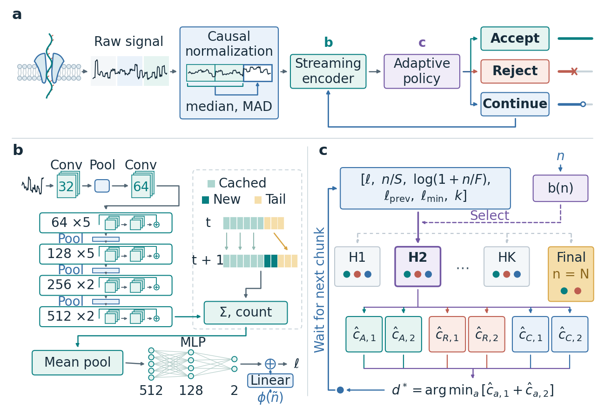

# PoreLoom

Streaming raw-signal classification with adaptive stopping for selective nanopore sequencing.

This repository contains the implementation, experiment scripts, and publication assets for the
Bioinformatics manuscript and Supplementary Notes revised on **4 November 2026**.

PoreLoom processes raw signal as chunks arrive and chooses Accept, Reject, or Continue for each read.
It can decide early when the available evidence is sufficient and continue observing ambiguous reads
up to a maximum budget.

<p align="center">
  
</p>

**Overview.** (a) Causally normalized chunks enter a streaming encoder. Accept retains a read,
Reject requests ejection, and Continue waits for more signal. (b) Cached features are reused;
boundary features are recomputed and pooled to represent the prefix. (c) A length-specific head
maps the current feature vector to normalized host pore time and target-rejection risk for each
action. The final head excludes Continue.

## Method

- **Causal normalization.** After skipping the first 1500 raw samples, the signal is normalized in
  fixed blocks of 480 samples. Each block uses the preceding usable signal's median and MAD,
  combined with training-set priors early in a read. Normalized values beyond 3.5 in absolute
  value are replaced by the last inlier, or zero if none precedes them. Normalized values remain fixed as signal arrives, with the same output for any incoming chunk boundaries.
- **Streaming encoding and feature reuse.** A ReadCurrent-derived backbone is pretrained on
  windows from random initialization, then trained on streaming prefixes. Finalized feature
  frames are cached as a running sum and count; features near the growing right boundary are
  recomputed. Pooling and a length correction yield the target-minus-host logit margin.
- **Factorized action-cost policy (FACP).** A head selected by observed length predicts normalized
  host pore time `U` and target-rejection risk `R` for each legal action. The main policy minimizes
  `U + R` (`beta = 1`), with heads fitted backward on training reads and early-stopped on validation
  reads. The six inputs are the current, previous, and minimum logit margins, two length features,
  and the number of decision steps. Each head interval is evaluated at most once per read.

The default usable budget is 6000 samples, after the 1500 skipped samples. The final head is
applied at the first observation reaching the 7500-raw-sample endpoint (1.875 s at 4 kHz,
1.5 s at 5 kHz), provided the read is still available. Decisions start at 432 usable samples,
and ordinary head intervals span 768 usable samples. The additional beta experiment is confined
to Supplementary Note 6 and Figure S4; all main analyses use beta 1.

## Results

Offline evaluation replays all test reads with observations every 0.4 s. Reads without a completed
command are retained, including reads too short to fill a baseline window. Accuracy and rejection
rates count completed Reject commands; host pore time is shortened only when the subsequent
0.1-s ejection also completes before natural read termination. Closed-loop accuracy and rejection
rates instead count effective ejections.

Values are equally weighted means ± sample SD (`n=3`, `ddof=1`). Units are three simulated groups,
three R9 training repeats on one shared split, or three read-disjoint R10 mixed or sputum groups.
Budget experiments use three training repeats on one fixed group and test set; timing and closed-loop experiments use three timed repeats and
three simulator seeds, respectively. Paired differences and ratios are calculated within units.

| Dataset | Method | Accuracy | Hosts rejected | Targets rejected | Pore time per host read |
|---|---|---|---|---|---|
| Simulated | PoreLoom | 95.65 ± 0.07% | 97.04 ± 0.19% | 5.73 ± 0.34% | 1.664 ± 0.047 s |
| | Best baseline per metric | 92.41 ± 0.54% (RC-6000) | 92.77 ± 1.67% (RC-6000) | 5.18 ± 1.31% (ND-6000) | 3.154 ± 0.321 s (RC-6000) |
| R9 | PoreLoom | 91.81 ± 0.11% | 90.43 ± 0.55% | 6.81 ± 0.45% | 1.916 ± 0.052 s |
| | Best baseline per metric | 84.59 ± 4.85% (ND-3000) | 79.09 ± 14.45% (ND-3000) | 6.14 ± 1.91% (RC-6000) | 2.474 ± 0.200 s (ND-6000) |
| R10 mixed | PoreLoom | 95.64 ± 0.18% | 94.57 ± 0.14% | 3.28 ± 0.27% | 1.492 ± 0.028 s |
| | Best baseline per metric | 89.80 ± 2.71% (ND-6000) | 90.77 ± 2.39% (ND-3000) | 4.91 ± 1.73% (RC-6000) | 1.970 ± 0.346 s (ND-3000) |
| R10 sputum | PoreLoom | 92.29 ± 0.48% | 95.41 ± 0.36% | 10.83 ± 0.65% | 1.244 ± 0.033 s |
| | Best baseline per metric | 90.41 ± 1.01% (RC-6000) | 93.18 ± 1.46% (RC-6000) | 12.37 ± 0.56% (RC-6000) | 1.790 ± 0.172 s (RC-3000) |

Baselines are ReadCurrent (RC), NanoDeep (ND), and SquiggleNet, each trained with 3000- and
6000-sample windows and evaluated at the native probability threshold of 0.5. Each baseline row
above gives the best of these six models **separately for each metric**, as in manuscript Table 1.
PoreLoom's mean host rejection is 2.23–11.34 percentage points above the highest baseline mean,
and its mean host pore time is 23–47% below the lowest baseline mean.

- **Early decisions (Figure 2).** Among completed decisions, 51.27%, 45.25%, 82.38%, and 62.69%
  occur within 3000 usable samples on simulated, R9, R10 mixed, and sputum data, respectively;
  4.4–10.6% reach the 6000-sample budget. Figure 2a uses the frozen encoder's native 0.5 threshold
  without FACP.
- **Streaming encoding (Figure S1).** Compared with sliding-window encoding, streaming-prefix
  encoding improves mean accuracy by 1.36–2.55 percentage points, reduces target rejection by
  0.59–3.23 percentage points, and reduces host pore time in every dataset. Each encoder has
  a separately fitted FACP.
- **Feature reuse (Note 4, Figure S2).** On an RTX 2080 Ti, updating 512 reads at different prefix
  lengths after each additional 0.4 s of signal takes 132.9 ± 16.5 ms with reuse versus
  571.4 ± 1.8 ms with full recomputation. The paired speed ratio is 4.35 ± 0.58. These timings
  exclude FACP, queueing, and ejection. The maximum logit difference across tested configurations
  is 4.34e-6.
- **Stopping rules (Table 3, Table S2).** Fixed symmetric thresholds on the same frozen encoder
  reject if target probability `p < delta`, accept if `p >= 1 - delta`, and otherwise continue;
  at the 6000-sample budget they decide at `p = 0.5`. The current comparison uses
  `delta = 0.01, 0.05, 0.1, 0.2, 0.3`. At 0.01, target rejection is 0.48–2.15 percentage points
  lower than FACP, but mean host pore time is 0.29–0.45 s longer (19–36%). About 23–51% of
  all test reads are decided at the budget, versus 4–10% under FACP. At 0.05, mean host pore
  time remains 0.15–0.25 s longer than FACP.
- **FACP on frozen baselines (Table S3).** Adding FACP to the 3000-sample baselines raises mean
  accuracy by 2.23–6.00 percentage points in all 12 dataset–classifier combinations. Target
  rejection decreases in 11 combinations and host pore time decreases in 10. The augmented
  baselines still have lower mean host rejection, higher target rejection, and longer host pore
  time than PoreLoom in every dataset.
- **Larger budgets (Figure 3, Table S4).** On R10 mixed group 1, extending the usable budget
  from 6000 to 18000 samples raises mean accuracy from 95.61% to 96.21% and reduces host pore
  time from 1.501 to 1.337 s. On sputum group 1, extending to 12000 samples raises accuracy
  from 92.82% to 94.01%, with host pore time nearly unchanged (1.209 to 1.197 s). The fraction
  of all test hosts decided at the budget falls from 2.37 ± 0.18% to 0.55 ± 0.04% and from
  6.51 ± 0.42% to 2.25 ± 0.48%, respectively.
- **Closed-loop simulation (Table 2, Table S5).** Icarust runs use 512 channels for 1200 s.
  At target-molecule fractions of 1%, 10%, and 30%, PoreLoom's target-base enrichment over
  matched nonselective sequencing is 8.11 ± 0.48, 4.97 ± 0.12, and 2.63 ± 0.02. These means
  exceed the best baseline, 3000-sample NanoDeep, by 31.7%, 18.4%, and 8.5%.
- **Taxon holdouts (Note 5, Tables S6–S7).** PoreLoom has the highest host rejection in all
  12 sputum group–holdout comparisons and the lowest rejection of all test bacterial reads
  in 11. Retention of reads from excluded taxa is 31.90–64.49%; its advantage for those reads
  varies across baselines and holdouts.

## Installation

```bash
conda env create -f env/poreloom.yml      # Python 3.9, PyTorch 1.12.1
conda activate poreloom
pip install -e .                        # add [raw] for pyslow5, [dev] for pytest
```

Raw BLOW5 preparation uses a separate environment (`env/raw-requirements.txt`, Python 3.10,
pyslow5). Configure data and result roots outside the repository:

```bash
cp .env.example .env   # set PORELOOM_DATA and PORELOOM_RESULTS
```

Alternatively, copy `configs/paths.example.yaml` to `configs/paths.yaml`.

## Running PoreLoom

Train and evaluate the complete method on one dataset from random initialization:

```bash
python -m poreloom.method all --data <dataset root> --out <run dir> --fs <Hz> --device cuda:0
```

The stages are window pretraining (`stageA`), streaming-prefix training (`stream`), FACP fitting
at `beta = 1.0` (`head`), and test replay (`test`). Each stage can replace `all` in the command.
Model and action-head parameters are fitted on training reads; validation reads select checkpoints
and control early stopping. The main protocol fixes beta at 1.
Existing output directories reuse saved models and settings, so use a new directory when retraining.

| Option | Meaning |
|---|---|
| `--fs` | Acquisition rate in Hz (default 4000); replay times are samples / fs. |
| `--max-samples N` | Raw decision endpoint including the skipped prefix (default 7500, a 6000-sample usable budget). |
| `--max-decision-seconds T` | Endpoint as `floor(T * fs)` raw samples. For example, `--fs 5000 --max-decision-seconds 2.1` equals `--fs 5000 --max-samples 10500`. |
| `--replicate r` | Training repeat; offsets the training seeds. |

The encoder's length-feature scales remain 7500 samples and 4000 Hz across acquisition rates
and budgets. `--fs` sets the acquisition rate used for replay timing.

The legacy prefix-cache layout uses `train/`, `dev/`, and `test/`, documented in
`poreloom.method.data`. The current validation set corresponds to the legacy DEV-A subset. Caches must
cover the requested endpoint. Later stages and inference use the saved configuration. Budget
experiments can use prepared caches directly; rebuilding them from raw data requires the original
preprocessing readers, configured with `PORELOOM_DATA_PREP`.

Evaluate the five fixed symmetric-threshold controls on an existing trained encoder:

```bash
python -m poreloom.method.thresholds --data <dataset root> --run <trained run dir> --out <new control dir> --fs <Hz> --device cuda:0
```

This evaluates all five deltas from Table 3 and records `forced_decision_fraction_all_reads`
for the denominator used in Table S2. Every threshold is fixed before evaluation.

## Baselines

The main comparison uses each baseline's own normalization and native binary decision
(probability threshold 0.5):

```bash
python -m poreloom.method.baselines --tool readcurrent --data <dataset root> --out <run dir> --fs <Hz> --device cuda:0
```

`--tool` accepts `readcurrent`, `nanodeep`, or `squigglenet`. Use `--recipe upstream` for
NanoDeep to reproduce its paper training configuration. The dated 6000-sample workflow is
archived in `experiments/20261016_window6000/win6000.py`.

For baseline runs, install the upstream code under `third_party/`:

| Directory | Upstream | Manuscript commit | License |
|---|---|---|---|
| `third_party/ReadCurrent` | [ReadCurrent](https://github.com/Ming-Ni-Group/ReadCurrent) | `6db8921` | MIT |
| `third_party/NanoDeep` | [NanoDeep](https://github.com/lysovosyl/NanoDeep) | `1abba04` | MIT |
| `third_party/SquiggleNet` | [SquiggleNet](https://github.com/welch-lab/SquiggleNet) | `fb7b206` | MIT |

The PoreLoom backbone in `src/poreloom/method/backbone.py` retains the ReadCurrent architecture
and MIT notice within this repository.

## Data

All sequencing data are public. Models are fitted only on their own dataset's training set;
validation is used for checkpoint selection and early stopping, and test reads are reserved
for evaluation. Main training and test sets are class balanced. The validation set is selected
from held-out reads by deterministic read-ID hashing.

| Family | Source | Hz | Training / Validation / Test per group | Experimental units |
|---|---|---|---|---|
| Simulated | GRCh38.p14 and eight bacterial references, Squigulator `dna-r10-min` | 4000 | 40,000 / 10,000 / 30,000 | 3 molecule and waveform groups |
| R9 | SRR25423905 (PRJNA994188), HEK293T and seven bacteria, R9.4.1 | 4000 | 40,000 / 10,000 / 20,000 | 3 training repeats on one split |
| R10 mixed | HG002 (SRR23215365, Zenodo 7695412) and Zymo D6322 (SRR23437037), R10.4.1 | 4000 | 40,000 / 10,000 / 20,000 | 3 read-disjoint groups |
| R10 sputum | ONT `pathogen_surveillance_2025.09`, barcodes 01–14, R10.4.1 | 5000 | 79,922–79,994 / 20,000 / 58,868–60,002 | 3 groups from one run |

Table S1 lists exact counts for each group, with R9 listed once because its three training repeats
share one split. The validation counts incorporate the author's 4 November correction, recorded
in `paper/data/revision_20261104/provenance.json`. R10 mixed is a computational mixture of two
separate acquisitions. Sputum uses genomic-locus grouping to keep 10-kb alignment-start bins
separate across groups and partitions. Supplementary Note 1 gives accessions, labels, and split details.

## Reproducing the paper

The active publication inputs are frozen in `paper/data/revision_20261104/`. Rebuild the three main
tables, seven supplementary tables, and seven figures directly from these saved results:

```bash
python -m pip install -r paper/requirements.txt
python paper/scripts/build_revision.py
python paper/scripts/verify_publication.py
```

[paper/README.md](paper/README.md) maps every current figure and table to its source data and
explains precision, experimental units, and denominators. Figure 2a's fixed-0.5 means and SDs use
the supplied precision of 0.01 percentage points. Earlier publication scripts, figure data, and
provenance are archived under `paper/legacy/20261030/`.

Current training and evaluation use `python -m poreloom.method all`, and the fixed-threshold
comparison uses `python -m poreloom.method.thresholds`. For larger budgets, set the raw endpoint
with `--max-samples` to the usable budget plus 1500. The frozen publication snapshot contains
the November beta=1 results, extended fixed-threshold comparison, and replacement closed-loop runs.

Dated experimental drivers and SLURM templates are archived in `experiments/`; see
[experiments/README.md](experiments/README.md) for their original protocols and current entrypoints.

The closed-loop comparison has 72 runs: eight strategies (nonselective sequencing, PoreLoom,
and three baselines at two windows), three target fractions, and three simulator seeds. The
current snapshot uses the nine replacement PoreLoom beta=1 runs and native-0.5 baseline runs.
Repeating the matrix requires Icarust 0.6.0, trained checkpoints, and the original simulation
support files `closed_loop.py` and `analyze_live.py`. Set `PORELOOM_SIMLOOP`
to their directory and configure model paths and compute settings. Raw signals, preprocessing
readers, read-ID split membership, checkpoints, and the HPC rerun environment provide the inputs
needed to repeat the experiments.

## Repository layout

```
src/poreloom/method/      data, backbone, FACP, pipeline, and main-comparison baselines
src/poreloom/baselines/   baseline models and preprocessing
src/poreloom/             streaming, replay, controller, and evaluation modules
experiments/              dated experimental drivers and cluster job templates
paper/data/revision_20261104/  frozen inputs for the current manuscript
paper/                    current tables, figures, rebuild scripts, and provenance
configs/, env/            path templates and environment specifications
tests/                    unit tests
```

## Tests

```bash
python -m pytest -q
```

## License

PoreLoom is released under the MIT License (see `LICENSE`). `src/poreloom/method/backbone.py`
contains ReadCurrent code (MIT License, Copyright (c) 2024 Kechen Fan).

## Citation

Citation information will be added after publication.
