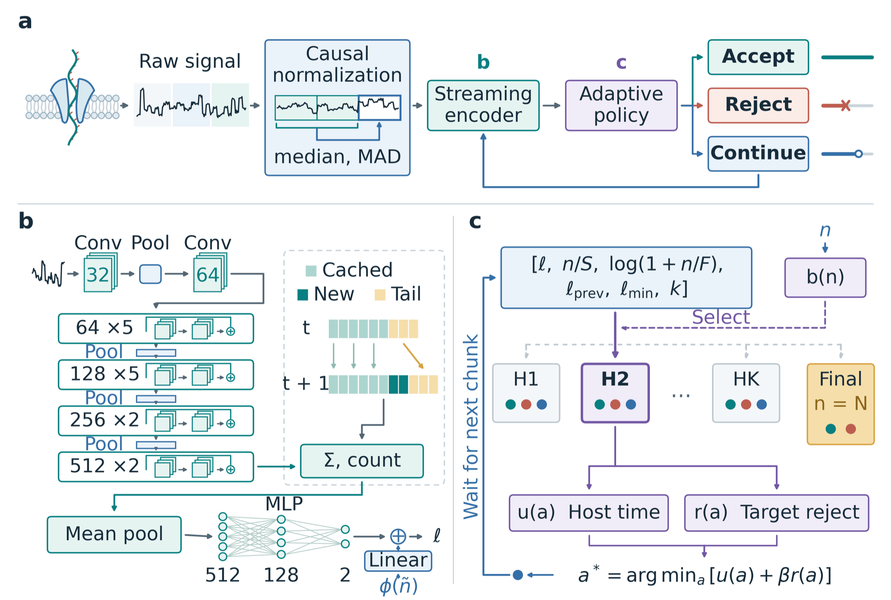

# PoreLoom

Streaming adaptive decisions for selective nanopore sequencing from raw signals.

Fixed-window classifiers wait for the same amount of signal on every read. PoreLoom instead reads raw signal as chunks
arrive and, at each callback, chooses Accept, Reject, or Continue for each read. Reads whose origin is already clear are
decided early, while uncertain reads keep observing up to a maximum budget.

<p align="center">
  
</p>

**Overview.** (a) Chunks pass through causal normalization and a streaming encoder. Each block (white) is scaled with
statistics of earlier blocks (teal). Accept sequences the read to its natural end, Reject requests ejection, and
Continue waits for the next chunk. (b) A ReadCurrent-derived backbone reuses stable features as the prefix grows and
recomputes features near its right boundary. Pooling and a length correction produce the target-minus-host logit.
(c) The current, previous, and minimum logits, observation length, and number of decision steps inform a
length-specific head. The chosen action minimizes the predicted normalized host time plus the weighted target-rejection
risk. The final head at the budget endpoint excludes Continue.

## Method

- **Causal normalization.** After the first 1500 samples are skipped, the signal is scaled in blocks of 480 samples.
  Each block uses the median and MAD of the preceding signal, averaged with training-set values early in a read when
  few samples are available. Values more than 3.5 standard deviations from the median are replaced by the most recent
  inlier. Normalized values never change once computed and do not depend on how the signal is split into chunks.
- **Streaming encoder with feature reuse.** The backbone follows the ReadCurrent architecture, is initialized by window
  pretraining, and is then trained on streaming prefixes of many lengths. Finalized feature frames are kept as a running
  sum and count, and only the frames affected by the right boundary are recomputed.
- **Factorized action-cost policy (FACP).** For each action, a head selected by the observed length predicts the
  normalized host pore time and the target-rejection risk. The policy chooses the action with the lowest
  `host time + beta * risk`. Heads are fitted backward from the final decision, and `beta` is selected on DEV-B.

By default the usable budget is 6000 samples, so the forced decision falls at 7500 raw samples (1.875 s at 4 kHz).

## Results

All offline numbers come from replay of recorded TEST reads with new signal every 0.4 s, averaged over three units
per dataset. Every method is evaluated on all TEST reads, including reads too short to fill a fixed window, which are
retained without a decision. Host and target rejection count completed Reject commands; host pore time is the mean
time a host read occupies the pore, including 0.1 s for ejection.

| Dataset | Method | Accuracy | Hosts rejected | Targets rejected | Pore time per host read |
|---|---|---|---|---|---|
| Simulated | PoreLoom | 95.71% | 95.73% | 4.32% | 1.960 s |
| | Best baseline per metric | 92.60% (ND-6000) | 92.61% (RC-6000) | 7.34% (ND-6000) | 3.163 s (ND-6000) |
| R9 | PoreLoom | 91.84% | 90.58% | 6.91% | 1.843 s |
| | Best baseline per metric | 86.19% (ND-3000) | 85.80% (ND-3000) | 5.68% (ND-6000) | 2.477 s (ND-3000) |
| R10 mixed | PoreLoom | 95.65% | 94.90% | 3.60% | 1.439 s |
| | Best baseline per metric | 91.71% (ND-6000) | 87.20% (ND-3000) | 2.23% (ND-6000) | 2.664 s (ND-6000) |
| R10 sputum | PoreLoom | 92.68% | 93.90% | 8.53% | 1.397 s |
| | Best baseline per metric | 90.31% (RC-6000) | 91.44% (RC-6000) | 10.81% (RC-6000) | 1.862 s (RC-3000) |

Baselines are ReadCurrent (RC), NanoDeep (ND), and SquiggleNet trained with 3000- or 6000-sample windows. The second
row of each dataset lists, for each metric, the best of the six baseline models. PoreLoom's host rejection is 2.46–7.70
percentage points above the highest baseline rate, and its host pore time is 25–46% below the lowest baseline value.
The complete table is Table 2 of the paper.

- **Early decisions.** Among completed decisions, 50.15%, 36.68%, 73.93%, and 56.22% occur within 3000 usable samples
  on simulated, R9, R10 mixed, and sputum data, while 5.8–14.2% reach the 6000-sample budget.
- **Streaming encoding.** Compared with a sliding-window encoder from the same initialization, the streaming encoder
  improves mean accuracy by 1.87–2.63 percentage points, lowers target rejection by 0.76–3.19 percentage points, and
  reduces host pore time in every dataset.
- **Feature reuse.** On an RTX 2080 Ti, updating 512 reads at different prefix lengths after each 0.4 s of signal takes
  141.3 ms with feature reuse versus 571.2 ms with full recomputation (4.0-fold). At a shared prefix length of 19200
  samples, the times are 122.2 and 572.9 ms (4.7-fold). Reused and recomputed logits differ by at most 4.35e-6.
- **Stopping rules.** On the same frozen encoder, fixed-length stopping needs 30–48% more host pore time than FACP.
  Constant and length-calibrated thresholds reach host rejection within 1.1 percentage points of FACP. FACP has the
  shortest host pore time on simulated, R9, and sputum data, and a constant threshold is 0.03 s faster on R10 mixed data.
- **FACP on existing classifiers.** Adding FACP to frozen 3000-sample baselines lowers target rejection by 1.01–5.02
  percentage points and raises accuracy by 0.39–5.65 percentage points in all 12 baseline/dataset means. The augmented
  baselines still reject fewer hosts, reject more targets, and use more host pore time than PoreLoom in every dataset.
- **Larger budgets.** Retraining with an 18000-sample budget on R10 mixed group 1 raises mean accuracy from 95.58% to
  96.25% while host pore time falls from 1.610 to 1.369 s. A 12000-sample budget on sputum group 1 raises accuracy from
  93.03% to 94.57%, with host pore time rising from 1.333 to 1.399 s.
- **Closed-loop simulation.** In Icarust runs with 512 channels for 1200 s, PoreLoom's retained target-base yield is
  7.84, 4.88, and 2.62 times that of nonselective sequencing at 1%, 10%, and 30% targets. The best baseline,
  3000-sample NanoDeep, reaches 6.15, 4.19, and 2.43, so PoreLoom's enrichment is 27.5%, 16.4%, and 7.9% higher.

### Limitations

- Some baselines preserve targets better: the 6000-sample NanoDeep model has lower target rejection on R9 (5.68% vs
  6.91%) and R10 mixed data (2.23% vs 3.60%), but misses more hosts and uses more host pore time.
- FACP has higher target rejection than length-calibrated thresholds on R9, R10 mixed, and sputum data, and the lowest
  sputum accuracy among the four stopping rules (92.68% vs 93.26% for the best).
- In closed-loop simulation at 1% targets, 6000-sample SquiggleNet has higher accuracy (98.50% vs 96.37%) by ejecting
  more hosts, although it ejects 33.51% of targets and has lower enrichment.
- Target rejection rises when an entire genus is removed from training, and some genera have high rejection even when
  included.
- Models do not transfer between datasets without retraining. Models trained on R10 mixed data and applied to sputum
  reject 79.97% of targets on average, so PoreLoom currently requires matched training data.
- The R10 mixed host and target reads come from separate sequencing runs, and the sputum data are a spiked
  quality-control panel after host depletion.
- All results come from replay of recorded signals and simulation; PoreLoom has not yet been run on a sequencing device.

## Installation

```bash
conda env create -f env/readcurrent.yml   # Python 3.9, PyTorch 1.12.1
conda activate readcurrent
pip install -e .                          # add [raw] for BLOW5 input (pyslow5), [dev] for pytest
```

Raw BLOW5 preparation uses a separate environment (`env/raw-requirements.txt`, Python 3.10, pyslow5). Data and result
roots are set outside the repository:

```bash
cp .env.example .env   # set PORELOOM_DATA and PORELOOM_RESULTS
```

or copy `configs/paths.example.yaml` to `configs/paths.yaml`.

## Running PoreLoom

`poreloom.method` trains and evaluates the complete method on one dataset from random initialization, with no weights
from other data:

```bash
python -m poreloom.method all --data <dataset root> --out <run dir> --fs <Hz> --device cuda:0
```

The stages are window pretraining (`stageA`), streaming-prefix training (`stream`), FACP fitting with operating-point
selection on DEV-B (`head`), and TEST replay (`test`). Each stage can be run on its own in place of `all`.

| Option | Meaning |
|---|---|
| `--fs` | Sampling rate in Hz (default 4000). Replay times are samples / fs. |
| `--max-samples N` | Raw decision endpoint, including the skipped prefix (default 7500, i.e. a 6000-sample budget). |
| `--max-decision-seconds T` | Endpoint given as a duration: `floor(T * fs)` samples. `--fs 5000 --max-decision-seconds 2.1` equals `--fs 5000 --max-samples 10500`. |
| `--replicate r` | Training repeat; all stage seeds are offset by r. |
| `--select` | Operating point on DEV-B: `max_acc` (default) or `frr:<limit>`. |

The dataset layout (TRAIN, DEV and TEST prefix caches) is documented in `poreloom.method.data`. Prefix caches must
cover the requested endpoint. Later stages and inference read the saved configuration.

## Baselines

The main comparison uses ReadCurrent, NanoDeep, and SquiggleNet as fixed-window classifiers, each with its own
normalization and a DEV-B threshold:

```bash
python -m poreloom.method.baselines --tool readcurrent --data <dataset root> --out <run dir> --fs <Hz> --device cuda:0
```

`--tool` is one of `readcurrent`, `nanodeep`, `squigglenet`. For NanoDeep, `--recipe upstream` uses the authors'
training settings instead of the shared recipe.

`poreloom.baselines` and `scripts/` contain an earlier native-window setup (NanoDeep on raw[1000:4000]; ReadCurrent,
CAFES, and SquiggleNet on raw[1500:4500]) with model builders, per-tool normalization, training and host-margin
scoring:

```bash
python scripts/train_baseline.py --tool nanodeep --output runs/nanodeep/seed20260929
python scripts/prepare_baseline_tiles.py --output runs/tiles          # ReadCurrent and CAFES need tiles first
python scripts/train_baseline.py --tool readcurrent --tiles runs/tiles --output runs/readcurrent/seed20260929
python scripts/score_baseline.py --tool readcurrent --role C_screen --output scores/readcurrent_C.npz
```

`--smoke` runs a tiny fit. The ReadCurrent and CAFES trainer needs torch >= 1.13.

These baselines load upstream code from `third_party/`, which is not distributed with this repository. Clone the
upstream repositories there before running them:

| Directory | Upstream | License |
|---|---|---|
| `third_party/ReadCurrent` | https://github.com/Ming-Ni-Group/ReadCurrent (commit 6db8921) | MIT |
| `third_party/NanoDeep` | https://github.com/lysovosyl/NanoDeep | MIT |
| `third_party/SquiggleNet` | https://github.com/welch-lab/SquiggleNet | MIT |
| `third_party/CAFES` | https://github.com/Chenshanming-repo/CAFES | MIT |

The PoreLoom backbone in `src/poreloom/method/backbone.py` is a copy of the ReadCurrent convolutional architecture and
keeps its MIT license notice, so PoreLoom itself does not need `third_party/`.

## Data

All sequencing data are public. Main test sets are class balanced, and every model is trained only on the TRAIN
partition of its own dataset. DEV is split by read-ID hash into DEV-A (early stopping and head fitting) and DEV-B
(operating-point selection).

| Family | Source | Hz | TRAIN / DEV / TEST per unit | Units |
|---|---|---|---|---|
| Simulated | GRCh38.p14 host and eight bacterial references, Squigulator `dna-r10-min` | 4000 | 40k / 20k / 30k | 3 molecule and waveform batches |
| R9 | SRR25423905 (PRJNA994188), HEK293T and seven bacteria, R9.4.1 | 4000 | 40k / 20k / 20k | 3 training seeds on one split |
| R10 mixed | HG002 (SRR23215365, Zenodo 7695412) and Zymo D6322 (SRR23437037), R10.4.1 | 4000 | 40k / 20k / 20k | 3 read-disjoint subsets |
| R10 sputum | ONT `pathogen_surveillance_2025.09`, barcodes 01–14, R10.4.1 | 5000 | ~80k / ~40k / ~60k | 3 groups from one run |

The R10 mixed data are a computational mixture of two separate acquisitions, not one sequencing run. Labeling,
deduplication, and partition details are given in Supplementary Section S1 of the paper.

## Reproducing the paper

`experiments/` contains the scripts that produced the reported runs, organized by date. They were run on a SLURM
cluster. The `hpc/` job files use placeholders (`/path/to/poreloom_work`, `<account>`, `<gpu partition>`) for the
working directory and cluster settings.

| Paper result | Scripts |
|---|---|
| Main comparison with 3000- and 6000-sample baselines (Table 2) | `experiments/20261014_final/hpc/`, `summarize.py`; `experiments/20261016_window6000/win6000.py` |
| Icarust closed-loop simulation (Table 3; Supplementary Section S10) | `experiments/20261014_final/icarust_run.py`, `icarust_live.py` |
| Fixed-prefix accuracy (Fig. 2a) | `experiments/20261015_ablation/fixed_window.py` |
| Decision positions (Fig. 2b) | `experiments/20261014_final/signal_budget.py`; `paper/scripts/signal_position_data.py` |
| Streaming versus window encoder, stopping-rule controls (Fig. 3a,b; Table 4) | `experiments/20261015_ablation/ablation.py` |
| Feature reuse versus full recomputation time (Fig. 3c; Supplementary Fig. S2) | `experiments/20261016_stream_timing/timing.py` |
| FACP on frozen 3000-sample baselines (Table 5) | `experiments/20261015_window_tools/native_cp.py` |
| Larger observation budgets (Fig. 4) | `experiments/20261016_budget_up/budget_up.py` |
| Online/offline decision agreement (Supplementary Section S5) | `experiments/20261014_final/icarust_check.py` |
| Observation-interval sensitivity (Supplementary Fig. S1) | `experiments/20261015_ablation/icarust_chunk.py` |
| Cross-dataset transfer (Supplementary Section S6, Fig. S3) | `experiments/20261015_cross_domain/` |
| Leave-taxon-out (Supplementary Section S11) | `experiments/20261014_final/lso.py` |

`paper/` regenerates the figures, tables, and numbers of the manuscript. `paper/figure_data/` holds the unrounded CSV
input of every plotted comparison, so the figures can be redrawn without the raw results:

```bash
cd paper
python -m pip install -r requirements.txt    # Python >= 3.10; no PyTorch or GPU needed
python scripts/plot_figures.py               # writes figures/
python scripts/draw_overview.py              # Fig. 1 schematic
```

The raw experimental results (read-level decisions and outcomes, selections, and logs for all reported runs) and the
read-level partition tables are archived on Zenodo: DOI to be added. To rebuild `figure_data/`, `tables/`, and
`numbers.tex` from them, extract the `results/` directory of the archive into `paper/results/` and run:

```bash
python scripts/prepare_results.py
```

## Repository layout

```
src/poreloom/method/      PoreLoom: data, backbone, streaming encoder, FACP heads, pipeline, main-comparison baselines
src/poreloom/baselines/   native-window baselines (NanoDeep, ReadCurrent, CAFES, SquiggleNet)
src/poreloom/             streaming, replay, controller, and evaluation modules used by the experiments
scripts/                  native-baseline CLI entry points
experiments/              scripts and job files of the reported experiments
paper/                    figure data, tables, and scripts that regenerate the manuscript figures
configs/, env/            path template and environment specs
tests/                    unit tests
```

## Tests

```bash
python -m pytest -q
```

## License

PoreLoom is released under the MIT License (see `LICENSE`). `src/poreloom/method/backbone.py` contains code from
ReadCurrent (MIT License, Copyright (c) 2024 Kechen Fan).

## Citation

Citation information will be added after publication.
