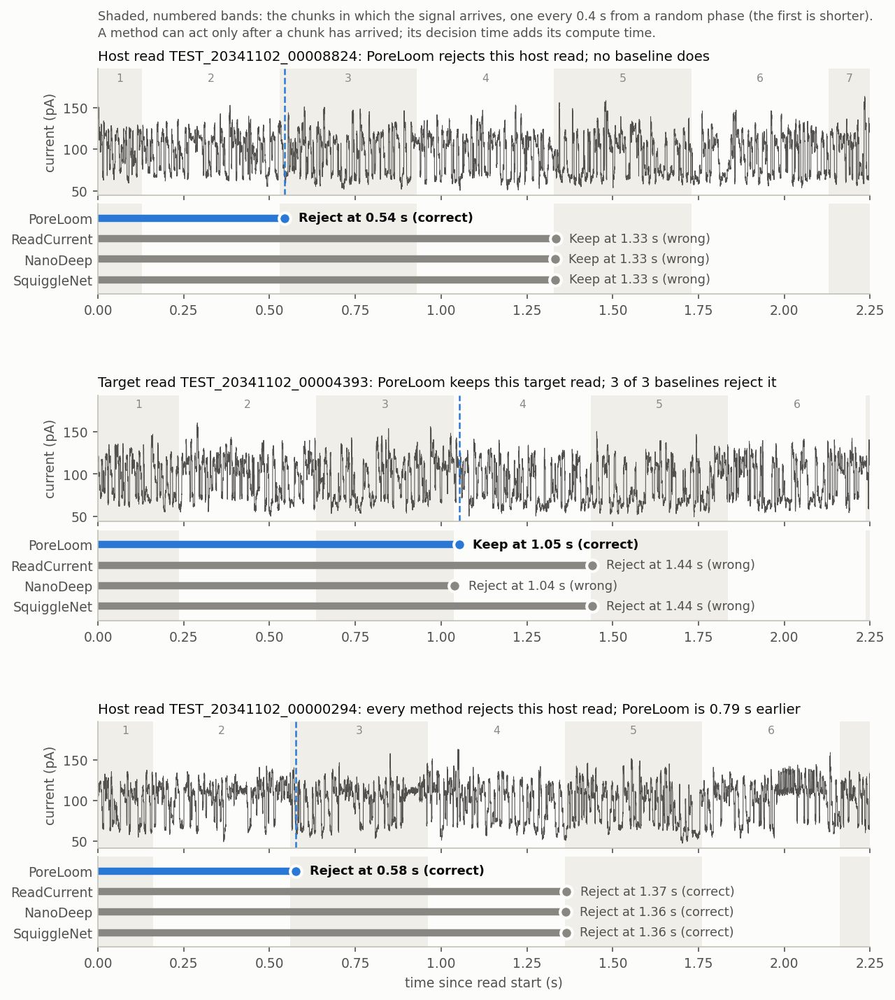

# Example: PoreLoom and baselines on 1,000 simulated reads

This example tests an installation using the bundled PoreLoom model and three baselines on a small
subset of the simulated test set. It retains the earlier `T_norm = 13.93 s` checkpoint and saved
reference outcomes. Current `T_norm = 15 s` publication results are in
[`paper/`](../paper/README.md); the new action-head checkpoints were not supplied with those results.
The results below come from the command in [Running the example](#running-the-example).

## Results

1,000 test reads (500 target, 500 host) from simulated group 1, replayed with an observation
every 0.4 s. Each baseline classifies one 3000-sample window at the position its original code uses:
NanoDeep skips the first 1000 samples (samples 1000-4000), ReadCurrent and SquiggleNet skip 1500
(samples 1500-4500); each uses its native probability threshold of 0.5. PoreLoom also skips the first
1500 samples and then decides from the growing signal.

| Method | Accuracy | Hosts rejected | Targets rejected | Pore time per host read |
|---|---|---|---|---|
| PoreLoom | 96.20% | 98.40% | 6.00% | 1.497 s |
| ReadCurrent | 86.50% | 89.60% | 16.60% | 3.325 s |
| NanoDeep | 86.50% | 87.60% | 14.60% | 3.572 s |
| SquiggleNet | 83.90% | 89.00% | 21.20% | 3.355 s |

The same bundled models on all 30,000 test reads of simulated group 1 in the historical reference:

| Method | Accuracy | Hosts rejected | Targets rejected | Pore time per host read |
|---|---|---|---|---|
| PoreLoom | 95.52% | 97.05% | 6.01% | 1.631 s |
| ReadCurrent | 87.74% | 89.08% | 13.60% | 3.326 s |
| NanoDeep | 86.63% | 86.97% | 13.71% | 3.646 s |
| SquiggleNet | 85.06% | 88.43% | 18.31% | 3.413 s |

Per-read outcomes identical to the saved historical reference: PoreLoom 1,000/1,000, ReadCurrent 1,000/1,000, NanoDeep 1,000/1,000, SquiggleNet 1,000/1,000.

## Example reads

Reads where PoreLoom does better than the baselines. Each panel shows the raw signal and, for every method,
how long it observed the read before its command; the dashed line marks PoreLoom's decision. The
shaded, numbered bands are the chunks in which the signal arrives, one every 0.4 s from a random phase
(so the first chunk is shorter); a method can act only after a chunk has arrived. ReadCurrent and
SquiggleNet need 4500 samples (1.125 s) and NanoDeep 4000 (1.000 s), so NanoDeep decides one chunk
earlier when a chunk ends between those two times.



## Running the example

```bash
pip install -e . matplotlib
python example/run_example.py --device cpu       # or --device cuda:0
```

This run took 47 s on a CPU. The script downloads four upstream baseline files into
`third_party/` on first use (ReadCurrent `6db8921`, NanoDeep `1abba04`, SquiggleNet `fb7b206`, all MIT) and
writes `metrics.json`, `per_read.csv`, `example_reads.png` and this `README.md` to `--out`
(default `example/output/`). The files in this folder were written with `--out example`.

## Contents

| Path | Content |
|---|---|
| `data/test/` | 1,000 reads in the prefix-cache layout of `poreloom.method.data`: int16 ADC of the first 9000 samples, calibration, class, and each read's replay phase in the paper (`phase`) |
| `models/poreloom/` | streaming encoder (`encoder.pt`) and FACP head (`head.pt`, beta = 1) |
| `models/readcurrent/`, `models/nanodeep/`, `models/squigglenet/` | 3000-sample baselines (`best.pt`) and their selection files with the service time used in replay |
| `reference/` | historical per-read outcomes for these reads and metrics on all group-1 test reads |
| `run_example.py` | the script that produced this page |

The simulated reads were generated with Squigulator (`dna-r10-min`, 4 kHz) from GRCh38.p14 (host) and eight
bacterial references (target). `data/test/manifest.json` and `models/manifest.json` record the selection
and the source files.
